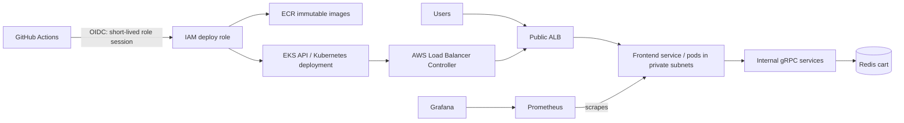

# Initial Online Boutique AWS architecture proposal (original target: Mumbai)

**Status:** This document preserves the initial Phase 0–1 proposal. The project region was later changed to `us-east-1`; current VPC design and Terraform implementation are recorded in [`aws-milestone-1-vpc-plan.md`](aws-milestone-1-vpc-plan.md) and [`../terraform/README.md`](../terraform/README.md). Terraform has since been initialized, formatted, validated, and planned for the networking module only. No AWS resources have been applied or changed. Upstream was pinned and used for the local deployment. See the [project journal](project-journal.md) for the chronology and current status. The Mumbai and three-AZ pricing in this proposal is historical and should not be used as the current estimate.

## Executive design

Run the unmodified Online Boutique application on Amazon EKS in `ap-south-1` (Mumbai). Keep upstream source in its own directory and maintain AWS infrastructure and delivery code in a separate project workspace. Build images in GitHub Actions, push immutable, scanned images to private ECR, and deploy to EKS using short-lived AWS credentials issued through GitHub Actions OIDC. Put the public frontend behind an internet-facing Application Load Balancer. Keep worker nodes and application pods in private subnets. Use AWS Load Balancer Controller to provision ALB resources from Kubernetes ingress objects. Run Prometheus and Grafana in-cluster initially, with persistent storage and resource limits.

### High-level request and delivery paths



## AWS components and decisions

| Area | Proposed design | Notes / approval point |
|---|---|---|
| Region | Mumbai `ap-south-1` | Confirm data-residency, latency, and account service quotas. |
| VPC | Dedicated `/16`, DNS support/hostnames enabled | CIDR must not overlap VPN, peered VPC, or office ranges. |
| Subnets | Three AZs; public subnets for ALB and NAT; private subnets for EKS nodes and pods | Public subnet routes to IGW. Private subnet routes through NAT. EKS nodes have no public IPs. |
| NAT | Production baseline: one NAT Gateway per AZ, with private subnets routed to same-AZ NAT | Highest resilience and avoids cross-AZ NAT traffic, but significant fixed charge. Cost-conscious dev alternative: one NAT Gateway, accepting AZ dependency and potential cross-AZ charges. For low egress, evaluate ECR API/Docker interface endpoints, S3 gateway endpoint, and other service endpoints after comparing endpoint-hour charges with NAT processing. |
| EKS | Managed control plane; private and public API endpoints, restricted public CIDRs at deployment time; managed node group spread across AZs | Starter uses 3× `t3.large` On-Demand nodes and autoscaling 3–6 as a sizing hypothesis only. Confirm architecture compatibility and workload/resource requests after local build and load profile. Consider Graviton only after checking all images. |
| ECR | Private repository, scan-on-push, immutable tags, lifecycle cleanup of untagged images | Use commit SHA tags; do not deploy mutable `latest`. |
| IAM | EKS node role and pod identities (EKS Pod Identity or IRSA) with least privilege | Avoid static AWS keys in Kubernetes or CI. Keep node role limited to node duties and image pulls. |
| AWS Load Balancer Controller | Installed with Helm after EKS; controller IAM policy scoped to supported controller policy and cluster resources | Use private subnets tagged for internal load balancers and public subnets tagged for internet-facing ALB discovery. Add TLS via ACM after DNS ownership is known. |
| GitHub Actions OIDC | Trust only `token.actions.githubusercontent.com`, audience `sts.amazonaws.com`, exact repository and protected deployment ref/environment | CI role gets ECR push and EKS describe permissions only; Kubernetes deploy access still needs a scoped EKS access entry and namespace RBAC. Lock branch/environment, pin third-party actions to full commit SHAs, and separate build from production deploy roles if needed. |
| Observability | Prometheus and Grafana in-cluster with PVCs, retention limits, RBAC, network controls, and dashboards/alerts | For production availability, use replicated/managed monitoring or remote-write; single in-cluster replicas are a demo baseline, not an HA monitoring plane. Avoid exposing Grafana publicly without SSO and TLS. |
| Ingress | Internet-facing ALB routes HTTPS to frontend; internal gRPC stays cluster-private | Decide domain, certificate, WAF, and access policy before production. |

## Repository inspection

Inspected upstream `main` at commit [`c7cb6d5bfd6ea3aed768634ebbcb98cb7a523712`](https://github.com/GoogleCloudPlatform/microservices-demo/commit/c7cb6d5bfd6ea3aed768634ebbcb98cb7a523712). The branch head may move; pin a reviewed tag or commit before implementation.

### Service inventory and request model

| Service | Language | Role | Port/interface in Kubernetes baseline |
|---|---|---|---|
| frontend | Go | Public storefront; session IDs; HTTP requests | HTTP :8080 behind frontend Service :80 |
| cartservice | C# | Cart operations backed by Redis | gRPC :7070 |
| redis-cart | Redis | In-memory cart store | TCP :6379 |
| productcatalogservice | Go | Product listing/search/detail | gRPC :3550 |
| currencyservice | Node.js | Currency conversion | gRPC :7000 |
| checkoutservice | Go | Checkout orchestration across cart, catalog, currency, shipping, payment, email | gRPC :5050 |
| paymentservice | Node.js | Mock credit-card payment | gRPC :50051 |
| shippingservice | Go | Mock shipping estimates | gRPC :50051 |
| emailservice | Python | Mock confirmation email | gRPC :5000; health endpoint also declared |
| recommendationservice | Python | Product recommendations | gRPC :8080 |
| adservice | Java | Contextual text ads | gRPC :9555 |
| loadgenerator | Python/Locust | Generates shopping flows against frontend | Client workload |
| shoppingassistantservice | Python | Newer source service | Present in Docker/Skaffold source; not in current Kubernetes/release/Helm set |

The common runtime path is browser → frontend → catalog/currency/cart/ad; checkout calls cart, catalog, currency, shipping, payment, and email; cart calls Redis. The load generator is an optional traffic source and should be disabled or scaled down by default to control spend. The published README describes 11 services; the current tree includes the additional shopping assistant source, so deployment should pin a consistent tag/commit and decide explicitly whether to include it.

The upstream README documents 11 gRPC microservices: frontend (Go), cartservice (C#), productcatalogservice (Go), currencyservice (Node.js), paymentservice (Node.js), shippingservice (Go), emailservice (Python), checkoutservice (Go), recommendationservice (Python), adservice (Java), and loadgenerator (Python/Locust). At the current `main` tree, source and `skaffold.yaml` additionally include `shoppingassistantservice` (Python), but it is absent from the checked-in Kubernetes manifests, Helm chart, and release manifests. Treat this as an upstream source/deployment mismatch to resolve against the chosen tag before shipping.

The repository contains per-service Dockerfiles under `src/`. `skaffold.yaml` builds Linux AMD64 and ARM64 images using Docker BuildKit and Git-commit tags, then applies Kustomize manifests. The standard `kubernetes-manifests/` README says those image placeholders require Skaffold; `release/kubernetes-manifests.yaml` and `release/istio-manifests.yaml` contain prebuilt images from Google's Artifact Registry. The checked `release/kubernetes-manifests.yaml` uses per-service ClusterIP services, gRPC probes, resource requests/limits, non-root users, dropped Linux capabilities, and read-only root filesystems for containers. `kubernetes-manifests/` is a Skaffold build input with image placeholders; its README directs users to `release/` when using prebuilt images. Redis is the cart backend. The frontend exposes HTTP on port 8080; internal services communicate over gRPC.

`helm-chart/` is explicitly marked experimental in its README. Its default image repository points at Google Artifact Registry. Values include controls for service accounts, network policies, sidecars, authorization policies, OpenTelemetry, optional external databases, and frontend exposure; some documented advanced settings are GKE/Google-specific (for example Spanner and GKE workload identity annotations). `kustomize/` contains base resources and optional Google Cloud-specific components. `.github/terraform/` uses the Google provider, GCS remote state, Google project services, and GKE resources, so it is not an AWS module to reuse. The README quickstart provisions GKE Autopilot and applies the release manifest.

The full Dockerfile set and Kubernetes manifest set were inventoried and reviewed through the read-only GitHub connector; representative Dockerfiles and manifests were opened directly. Dockerfiles use multi-stage builds for Go, .NET, Node.js, Java, and Python, pin several base images by digest, and produce small runtime images (including distroless for Go). Skaffold declares `linux/amd64` and `linux/arm64` builds. The local clone failed due DNS, and local image builds remain unverified because Docker's selected daemon socket is missing. The target repository is accessible with admin/push permission; Milestone 1 is being added only on a new feature branch. Preserve Google source and put AWS-specific implementation in this separate repository.

## Cost estimate (planning range, USD/month)

This is a rough steady-state estimate for 730 hours/month, three AZs, 3× `t3.large` On-Demand nodes, one standard-support EKS cluster, one internet-facing ALB, three NAT Gateways, modest demo traffic, and small ECR/monitoring storage. Exact Mumbai prices, current instance availability, support tier, public IPv4 charges, taxes, and traffic assumptions require the AWS Pricing Calculator and account-specific verification before approval.

| Cost driver | Planning estimate/month | Assumption |
|---|---:|---|
| EKS control plane | ~$73 | AWS currently lists $0.10/cluster-hour for standard support; extended support is $0.60/hour. |
| Worker EC2 | ~$180–$230 | Three always-on `t3.large` nodes; validate Mumbai On-Demand rate and CPU credit behavior. |
| NAT gateways | ~$130–$170 + processing | Three AZ-local gateways; budget roughly $0.05–$0.06/hour each plus per-GB processing and Internet transfer. |
| ALB | ~$20–$50 | Hourly ALB charge plus low-to-moderate LCU use; HTTPS/data volume can raise it. |
| EBS | ~$15–$40 | Node root volumes plus modest Prometheus persistence. |
| ECR | ~$1–$10 | Roughly 10–100 GB retained; storage, not image pulls within-region, dominates. |
| Public IPv4, logs, metrics, misc. | ~$15–$80 | Depends on public address count, CloudWatch ingestion/retention, endpoint selection, and alarms. |
| Data transfer / NAT processing | ~$10–$100+ | Highly workload dependent; load generator and image pulls can increase this. |
| **Indicative total** | **~$445–$750/month** | Before taxes, support plan, domain, WAF, backups, and heavy egress. |

A one-NAT development variant can reduce fixed network spend by roughly $85–$115/month, but weakens AZ independence and may add cross-AZ transfer. Schedule non-production teardown or use short-lived environments to lower compute, control-plane, NAT, ALB, and public-IP hours. Set an AWS Budget and cost alerts before creating billable resources. Prometheus storage and load-generator traffic should be explicit cost controls.

Sources (pricing changes; recalculate before provisioning): [EKS pricing](https://aws.amazon.com/eks/pricing/), [VPC/NAT Gateway pricing](https://aws.amazon.com/vpc/pricing/), [Elastic Load Balancing pricing](https://aws.amazon.com/elasticloadbalancing/pricing/), [ECR pricing](https://aws.amazon.com/ecr/pricing/), [EC2 On-Demand pricing](https://aws.amazon.com/ec2/pricing/on-demand/), and [Online Boutique repository](https://github.com/GoogleCloudPlatform/microservices-demo).

## Target repository baseline

At inspection time, `main` had one 104-byte `README.md` (commit `e7016d99a165083f67ccadf38cfbe1f9d147981a`). That existing file is intentionally left unchanged. Architecture and implementation-plan files are being added on a feature branch.

## Workspace layout

```text
work/
└── microservices-demo/                 # Google upstream clone; currently blocked by DNS
outputs/
├── online-boutique-devops/              # Separate AWS workstream
│   ├── README.md
│   ├── terraform/
│   │   ├── versions.tf, variables.tf, main.tf
│   │   └── modules/
│   │       ├── networking/              # VPC, public/private subnets, IGW, NAT
│   │       ├── ecr/                     # Private repo, immutable tags, lifecycle
│   │       ├── eks/                     # Managed EKS cluster and node group
│   │       └── github_oidc/             # GitHub trust and limited ECR/EKS role
│   ├── kubernetes/                      # To add: AWS-specific ingress/observability overlays
│   └── .github/workflows/               # To add after repo/ref and deployment approval
├── online-boutique-aws-architecture.md
└── online-boutique-implementation-plan.md
```

The Terraform starter uses community modules for VPC and EKS and native AWS resources for ECR/OIDC IAM. It is a reviewable scaffold, not yet deployment-ready: OIDC owner/repository values are placeholders; GitHub OIDC provider may already exist in the account; controller IAM policy and Helm release configuration remain to be added; EKS version and endpoint CIDRs are required inputs; access entries and CI deployment permissions need least-privilege design; and Terraform state backend/locking is not configured. Terraform has not been initialized or applied.
